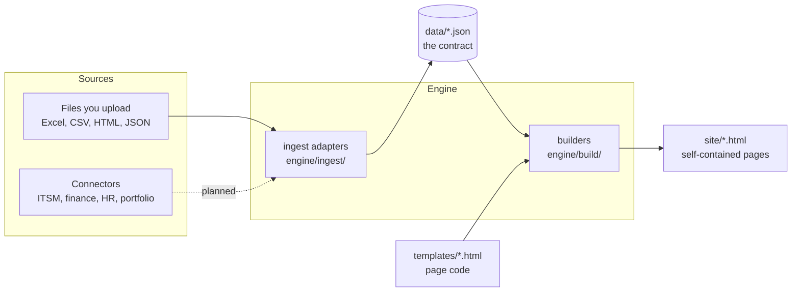

# Architecture

What exists today is the frontend output, driven by sample source files. This note records how it is
laid out so that an engine can be added later without rebuilding the pages.

The governing idea: **most content is static, and pages are generated by scripts, with no model output
involved.** Given a source file, the engine produces the same pages every time. Anything that would need
judgment on each refresh is written once as a rule in a script.

## The shape

The one rule that makes the rest possible: **pages depend on `data/`, never on where the data came from.**
A chargeback file dropped in `sources/` and a finance connector polled every night must both produce the
same `data/chargeback.json`. Swapping one for the other touches one adapter and nothing else.

## What each part does

| Part | Job | Today | Later |
|---|---|---|---|
| `sources/` | Hold raw exports | Files placed by hand | Also an upload box, or skipped entirely by connectors |
| `engine/ingest/` | Read one kind of source, validate it, aggregate it, write one data file | `chargeback` (file), `leadership` (edited page) | One adapter per source: file or connector |
| `data/` | The normalized record per section | `chargeback.json`, `leadership.json` | One file per section and sub-page |
| `templates/` | The page code, one file per page, with an empty data block | Front page, leadership chart, chargeback overview | One template per page |
| `engine/build/` | Put data files into a template's data block and write the page | `frontpage`, `leadership`, `chargeback` | One builder per page |
| `site/` | What people open | Front page, leadership chart, chargeback overview and line detail | Every section and sub-page |

Every data file says where it came from in a `source` block (`kind`: `file`, `connector` or `manual`;
`name`; `range`; `generated`). The pages show that as "Figures to ... · prepared ...", so a reader can
always tell how fresh a number is.

## Two ways data will arrive

**1. A file is uploaded.** Three places this can happen; the first works now.

- *In the repository:* drop the export in `sources/`, run `ingest` then `build`. Claude Code can do this
  from a plain request.
- *On the published page (planned):* an "Upload data" button reads the file in the browser, runs the
  same aggregation, and saves the result to the page's database so everyone sees it. The leadership
  page already works this way for edits and photos.
- *On a server (planned):* an upload endpoint runs `ingest` and `build` and republishes.

**2. A connector pulls it.** A connector adapter lives in `engine/ingest/` beside the file adapters and
writes the same data file. Connections are declared as project MCP servers in `.mcp.json` at the
repository root, with secrets taken from environment variables (`${VAR}`), never written in the file.
A scheduled run (Claude Code scheduled task, CI job or cron) calls `ingest` for each connector, then
`build`, then publishes.

Likely connectors per section, to confirm with the owners of each tool:

| Section | Source to connect | Replaces |
|---|---|---|
| Chargeback | Finance or time-booking system | The monthly chargeback export |
| Operational KPIs | ITSM tool (incidents, changes, SLA) | Nothing yet: no source connected |
| Projects | Portfolio tool (status, RAG, milestones) | Project names inferred from chargeback |
| People | HR system (headcount, location, role) | Headcount inferred from who charged time |
| Organization | HR system or the leadership page's own Edit mode | `data/leadership.json` kept by hand |

## Design choices that keep the engine possible

- **Self-contained pages.** A page is one file with its data inside. It can be mailed, opened offline,
  published as an artifact or served from any platform. The engine's only output is that file.
- **A data block per page.** Updating a page means replacing one JSON block. A script can do it
  (`engine/pages.py`), and so can the page itself in the browser, which is how "Download HTML" works.
- **Aggregation happens in the adapter.** Person-level and line-level rows stay in the source.
  Pages receive totals, so a page can be shared more widely than its source.
- **Adapters are small and separate.** Each has one `run()` that takes a source and writes a data file.
  A connector adapter needs the same function with a different first step.
- **No build tools or packages.** Python standard library and plain HTML, so anyone who clones the
  repository can run it.
- **No model in the loop.** Ingest and build are deterministic scripts. They can run from a terminal, a
  scheduled job or CI with nobody watching. Wording on pages that depends on the data ("up 74% on Jan")
  is assembled by the page code from the figures, never written by hand or by a model.
- **Code and data are kept apart.** Templates and scripts never contain data; sources, data, photos and
  built pages live in their own folders. Any of them can be excluded from the repository without touching code.

## What a full engine adds, in order

1. An adapter and data file for each remaining section (start with whichever has a sample export).
2. Validation: reject a source that does not match the contract, with a message naming the column.
3. History: keep each period's data file so pages can show change over time.
4. Connectors in `.mcp.json` and a scheduled refresh.
5. Upload on the page itself, for people who will never open the repository.
6. Platform features when hosted (sign-in, roles, a model gateway for "ask the portal"). These attach
   to the pages through one small adapter file per platform; the pages work without them.

Nothing in steps 1 to 6 requires changing how pages are written today.
